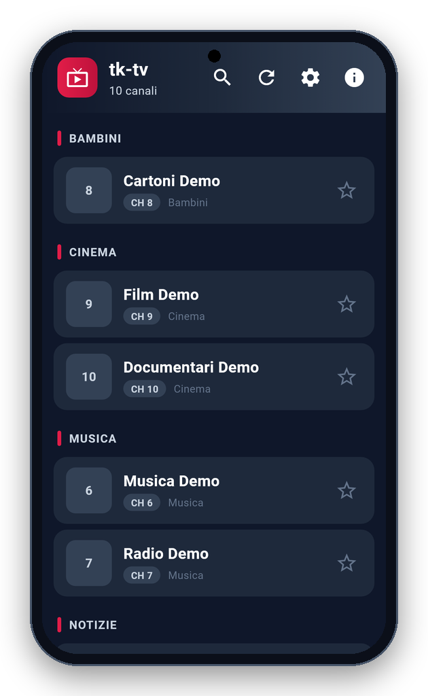
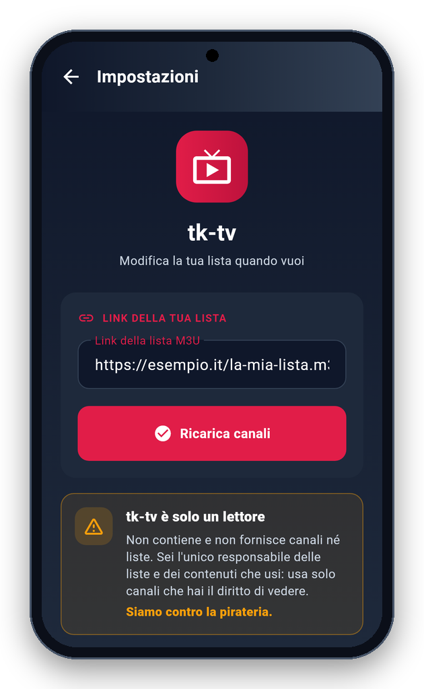
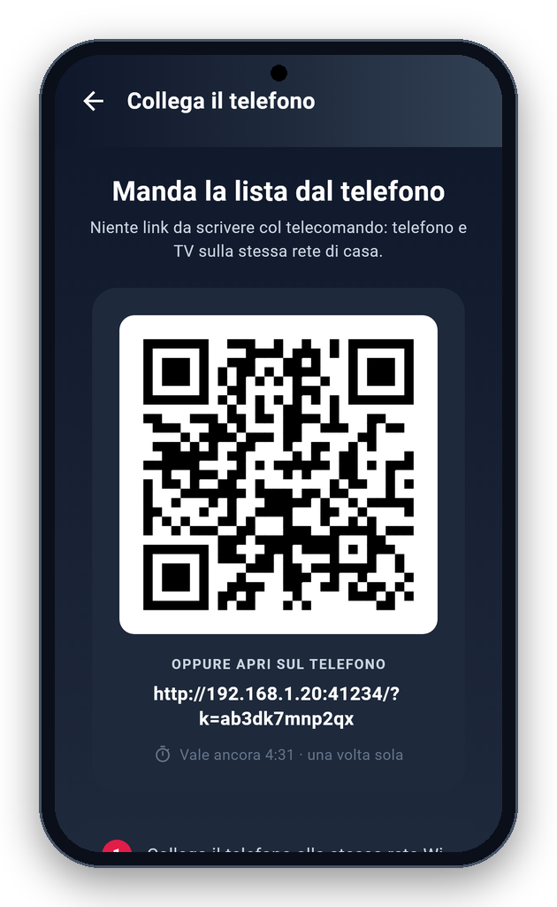

<!-- README generato da Dropbox/CLAUDE/dev/agpl-rollout/readme/genera_readme_app.py: modificare lì -->
<div align="center">


<br><br>

<a href="https://pietrodefilippis.it/scarica-app/tk-tv/"></a> &nbsp; <a href="https://pietrodefilippis.it/donazione/"></a>

<br><br>

<a href="COPYING"></a>   

</div>

> [!IMPORTANT]
> **tk-tv è solo un lettore:** non contiene e non fornisce canali né liste. Sei l'unico responsabile delle liste e dei contenuti che usi: usa solo canali che hai il diritto di vedere. Siamo contro la pirateria.

---

## ✨ Cosa fa

<table>
<tr>
<td width="50%" valign="top">

### 📺&nbsp; La tua lista M3U
Apre la lista che indichi tu, divisa per gruppi.

</td>
<td width="50%" valign="top">

### ⭐&nbsp; Evidenza e preferiti
Canali in evidenza, preferiti e ricerca.

</td>
</tr>
<tr>
<td width="50%" valign="top">

### 🎮&nbsp; Telecomando
Zapping col telecomando sulle TV Android.

</td>
<td width="50%" valign="top">

### 🚀&nbsp; App di streaming
Lancia quelle già installate sul dispositivo.

</td>
</tr>
<tr>
<td width="50%" valign="top">

### 📱&nbsp; Link dal telefono
Mandi la lista alla TV con un QR, sulla rete di casa: nessun server esterno.

</td>
<td width="50%" valign="top">

### 🖥️&nbsp; Ogni schermo
Televisori, proiettori, telefoni e tablet.

</td>
</tr>
</table>

## 📱 Com'è fatta

<div align="center">

<table align="center">
<tr>
<td align="center" valign="top"><br><sub><b>Canali</b></sub></td>
<td align="center" valign="top"><br><sub><b>Lista</b></sub></td>
<td align="center" valign="top"><br><sub><b>Abbinamento</b></sub></td>
</tr>
</table>

</div>

## 🔒 I tuoi dati

- **Abbinamento col telefono:** la TV apre un piccolo server sulla rete di casa e mostra un QR con il suo indirizzo locale (`http://<ip>:<porta>/?k=<codice>`); il telefono, sulla stessa rete, apre la pagina e invia il link. Nessun server esterno; il codice è casuale, vale 5 minuti e una volta sola.
- **Privacy:** il link della lista e i preferiti restano sul dispositivo. In rete l'app contatta gli indirizzi della tua lista (canali e loghi) e Dropbox per gli aggiornamenti. Le statistiche anonime (una volta al giorno: nome, versione, sistema e un codice casuale) partono solo se dici sì nel benvenuto o in Informazioni.

Nessuna pubblicità, nessun account da creare, nessun abbonamento: tutte le funzioni sono gratis, per tutti.

## 📥 Installazione

- **Android** — [scarica l'app](https://pietrodefilippis.it/scarica-app/tk-tv/) da pietrodefilippis.it e aprila: Android chiede una volta il permesso di installare app da questa origine. Gli aggiornamenti arrivano da soli, l'app te li propone. A breve anche su Google Play.
- **Piattaforme:** Android, Android TV e iPhone. C'è anche per Windows e Mac: [tk-tv per computer](https://pietrodefilippis.it/software/).

<details>
<summary><b>🛠️ Compilare dal codice sorgente</b></summary>

<br>

Serve [Flutter](https://flutter.dev) (versione indicata in `.github/workflows/android.yml`):

```bash
flutter pub get
flutter test
flutter build apk --release
```

Senza la variabile `ANDROID_KEYSTORE` l'APK si firma con la chiave di debug di Flutter.

</details>

## 📜 Licenza

**tk-tv** è software libero: © 2026 Pietro De Filippis (TecnikGeek), licenza
**[GNU Affero General Public License v3.0](COPYING)**. Puoi usarlo, studiarlo, modificarlo e condividerlo; è
fornito **così com'è, senza alcuna garanzia**.

> Il nome **tk-tv** e il logo non sono coperti dalla licenza (AGPL, sezione 7): una versione modificata deve avere un nome diverso.

---

<div align="center">

**Ti è utile?** Tutte le funzioni sono gratis per tutti. Se vuoi, un caffè aiuta a migliorarla e a crearne altre.

<a href="https://pietrodefilippis.it/donazione/"></a>

<sub>Creata da <a href="https://pietrodefilippis.it">Pietro De Filippis · TecnikGeek</a> — Webmaster & UX/UI Designer</sub>

</div>
